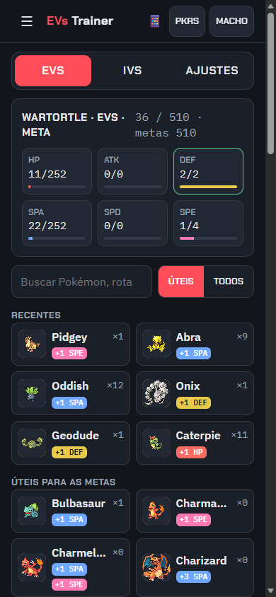
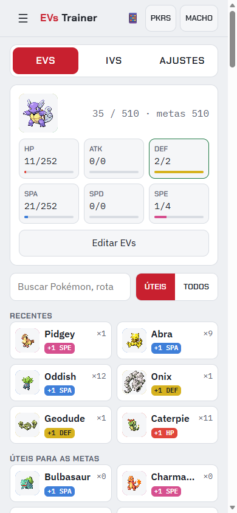
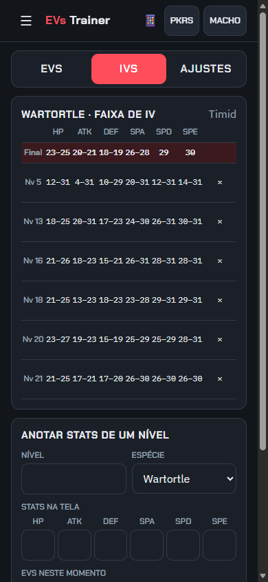
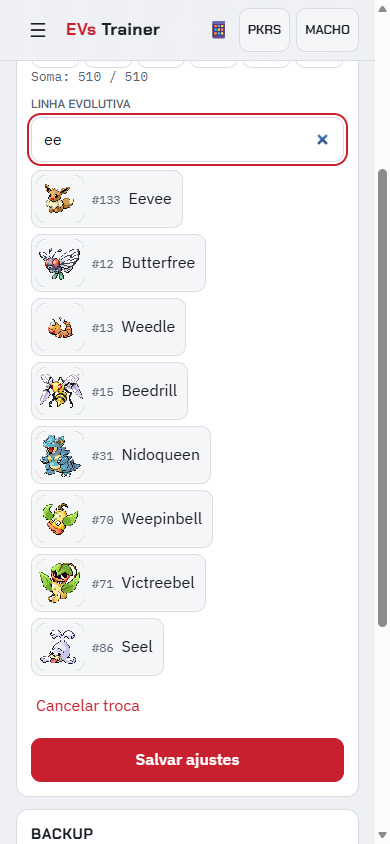
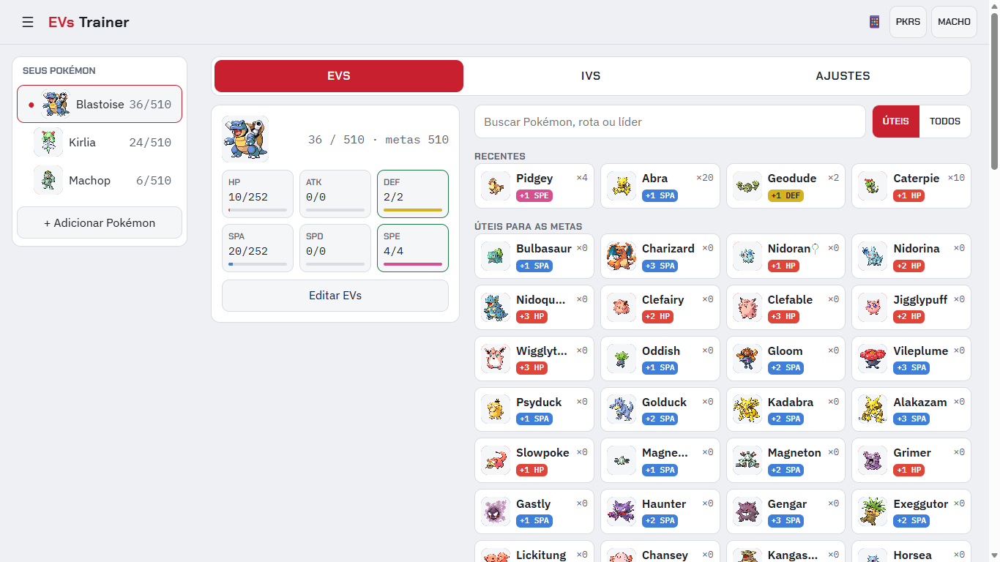

<div align="center">

# EVs Trainer

**Plan, count and verify EV training in Pokémon FireRed / LeafGreen — right next to your game.**

[](https://albertomonteiro.github.io/ev-trainer/)

[](https://github.com/AlbertoMonteiro/ev-trainer/actions/workflows/deploy.yml)
[](https://albertomonteiro.github.io/ev-trainer/)
[](#install-it-on-your-phone)
[](https://dotnet.microsoft.com/)
[](https://learn.microsoft.com/aspnet/core/blazor/)
[](https://learn.microsoft.com/dotnet/csharp/whats-new/csharp-15)
[](tests/EvTrainer.Tests)
[](specs)
[](src/EvTrainer.Web/Localization)
[](https://github.com/AlbertoMonteiro/ev-trainer/commits/main)

### 👉 [albertomonteiro.github.io/ev-trainer](https://albertomonteiro.github.io/ev-trainer/)

</div>

---

FireRed (Gen 3) never shows EVs or IVs, and EVs can't be reset. EVs Trainer keeps the count for you:
tap the opponent you just defeated and it applies the real Gen 3 rules; note your stats when you level
up and it narrows down your IVs.

| EV counter (dark) | EV counter (light) | IV ranges | Species picker |
|:---:|:---:|:---:|:---:|
|  |  |  |  |



> The interface is in **English** and **Brazilian Portuguese**: the app follows your browser's language
> (Portuguese for `pt-*`, English otherwise) and you can switch any time in the menu — the choice is
> remembered on the device.

## Features

- **One-tap EV counting** — the whole opponent card is the button; consecutive taps are grouped and
  every battle can be undone.
- **Every Pokémon you can meet in FireRed** — all 386 Gen III species are opponents (Sevii Islands,
  trades and events included): Kanto EV yields come from a hand-curated table, the others from
  [PokeAPI](https://pokeapi.co/), checked against that table.
- **Real Gen 3 rules** — 255 per stat, 510 total, vitamins only below 100 (and not doubled),
  Pokérus and Macho Brace (×2 each, ×4 together) recorded per battle, totals always recomputed in order.
- **Find the right opponent fast** — "Useful" filter (only opponents that still help your targets),
  recents, and search by name, Pokédex number, route, gym leader or trainer location
  (`route 4` / `rota 4`, `brock`, `nidoran f`…); search results (and "All") list the opponents that help your
  current targets first.
- **IV calculator** — note the 6 stats after each level up; the app shows the possible IV range per
  stat for each level and the intersection of all of them, using integer Gen 3 math and your nature.
- **Is this catch worth keeping?** — right after catching, type the species, level, nature and the 6
  stats from the summary screen: each stat gets its IV range and a grade (Great/Good/Fair/Poor), plus an
  overall verdict weighted by how much each stat matters: the main attack stat (physical or special,
  from the species' base stats) weighs 3×, the others 1×, the useless one is ignored — one tap changes
  it, and the choice is remembered per species. The app keeps the best catch so far per species and tells you whether the new one is
  better or worse; "Add to my list" starts training it with the first IV note already filled in.
- **Fix it by hand when the game disagrees** — "Edit EVs" sets the exact values from the game, either
  keeping the history (a "manual adjustment" entry; later battles add on top of it) or erasing it,
  which always asks first and offers a backup. Known IVs (e.g. from the IV judge) override the
  estimate, with a warning when they contradict your notes, and level notes can be edited in place.
  Every change can be undone.
- **No typing base stats** — pick the species from an embedded Gen III Pokédex (#1–386, base stats as
  of Gen III); the evolution line fills itself, branches (Eevee, Gloom, Poliwhirl…) are one tap.
- **FireRed/LeafGreen sprites** everywhere, with a colored fallback badge (EV stat color + dex number)
  when an image can't be shown.
- **Phone and PC in sync (optional)** — keep a copy in a secret Gist of your own GitHub account and the
  app syncs it automatically between devices ([how](#optional-sync-your-phone-and-your-pc-with-a-secret-gist)).
- **Phone first, great on desktop** — on a wide window the EV summary stays in view next to a wide
  opponent grid, IVs / settings / capture evaluation sit side by side, and a side panel lists your
  Pokémon so switching is one click; the phone layout is unchanged.
- **Several Pokémon**, history, light/dark theme, spreadsheet paste import.

## Your data stays on your device

There is no app account and no app server. Everything is saved in the browser of the device you use,
after every tap. To move to another phone or browser (or just to be safe), use **Exportar backup** /
**Importar backup** in the menu — a plain JSON file. Without sync turned on, the app makes no requests
to third parties.

### Optional: sync your phone and your PC with a secret Gist

Turn it on in the menu → **Sincronização**. The app keeps a copy of your data in a **secret Gist of
your own GitHub account** and syncs it by itself: when the app opens, when you come back to it and a
few seconds after each change. Edits on both devices are merged per Pokémon (the most recent change
wins, deletions included), and nothing is lost while you are offline.

1. Create a [fine-grained personal access token](https://github.com/settings/personal-access-tokens/new)
   with only **Account permissions → Gists: Read and write** (no repository access), or a classic token
   with only the `gist` scope.
2. Paste it in **Sincronização** and tap **Conectar**. Do the same on your other device.

Good to know: the token stays only on that device (never in backups or in the Gist) and
**Desconectar** removes it. A secret Gist is unlisted, not private — anyone with its link can read it;
it only holds your Pokémon training data. The app talks to the GitHub API straight from your browser;
there is still no app server.

## Install it on your phone

Open the [app](https://albertomonteiro.github.io/ev-trainer/) and choose **Add to Home screen**
(Android/Chrome) or **Share → Add to Home Screen** (iOS/Safari). After the first visit it works
**offline**.

New versions are picked up automatically: the app checks for updates when it opens and whenever it
comes back to the foreground, and reloads itself once when a new version is ready. The version and
commit you're running are shown at the bottom of the ☰ menu.

## Tech stack

| | |
|---|---|
| Runtime | [.NET 11](https://dotnet.microsoft.com/) (C# 15), Blazor WebAssembly standalone, PWA |
| Hosting | GitHub Pages, deployed by [GitHub Actions](.github/workflows/deploy.yml) on every push to `main` |
| Tests | xUnit v3 on Microsoft Testing Platform + bUnit — test-first (TDD) |
| Data | `localStorage` (same format as the backup file); embedded [`reference-data.json`](reference-data.json) and [`pokedex-gen3.json`](pokedex-gen3.json) |
| C# 15 in use | closed hierarchies (IV cells), union types (backup read result), collection-expression arguments, labeled `continue` |

The project is spec-driven with [Spec Kit](https://github.com/github/spec-kit): see the
[constitution](.specify/memory/constitution.md) and the feature folders in [`specs/`](specs).

## Development

Requirements: the .NET 11 SDK pinned in [`global.json`](global.json) and the WebAssembly workload.

```bash
dotnet workload install wasm-tools
```

```bash
dotnet test --solution PokemonEvTrainer.slnx
```

```bash
dotnet run --project src/EvTrainer.Web --launch-profile http
```

Then open http://localhost:5010. Formatting is checked in CI:

```bash
dotnet format PokemonEvTrainer.slnx --verify-no-changes
```

Regenerating the embedded data (file-based apps, no extra project):

```bash
dotnet run scripts/BuildPokedex.cs
```

```bash
dotnet run scripts/DownloadSprites.cs
```

### Project layout

```text
src/EvTrainer.Web/          Blazor WebAssembly app
  Domain/                   pure C# game rules (EVs, IVs, search, import, backup) — no UI, no I/O
  Components/ Pages/        UI
  Localization/             UI strings (strings.pt-BR.json)
  State/                    in-memory store + localStorage repository
  wwwroot/                  index.html, CSS, fonts, sprites, service worker
tests/EvTrainer.Tests/      xUnit + bUnit tests
scripts/                    data generators (Pokédex, sprites)
specs/                      Spec Kit specifications, plans and tasks
```

## Credits

- Pokémon data and sprites from [PokeAPI](https://pokeapi.co/) and
  [PokeAPI/sprites](https://github.com/PokeAPI/sprites) (see
  [`sprites/CREDITS.md`](src/EvTrainer.Web/wwwroot/sprites/CREDITS.md)).
- Fonts: [Chakra Petch](https://fonts.google.com/specimen/Chakra+Petch),
  [IBM Plex Sans and Mono](https://www.ibm.com/plex/) — SIL Open Font License.

## Disclaimer

This is a free, non-commercial fan project. It is not affiliated with, endorsed or sponsored by
Nintendo, Creatures Inc., GAME FREAK inc. or The Pokémon Company. Pokémon and Pokémon character names
are trademarks of Nintendo; Pokémon images © The Pokémon Company.
